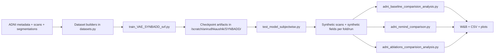
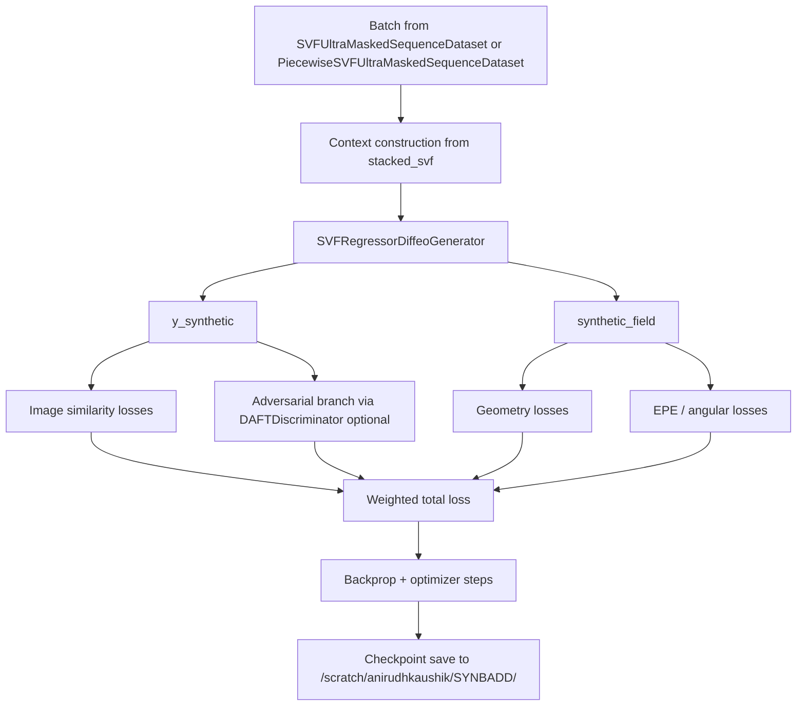
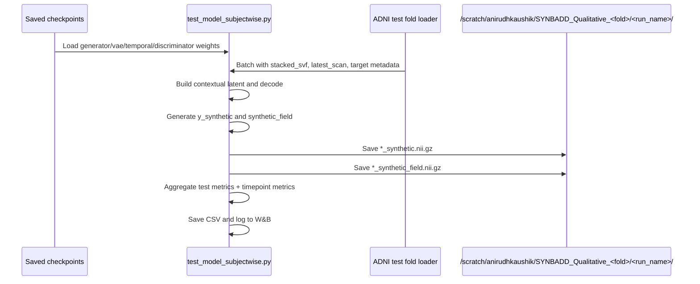
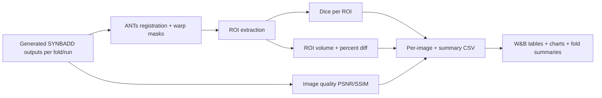
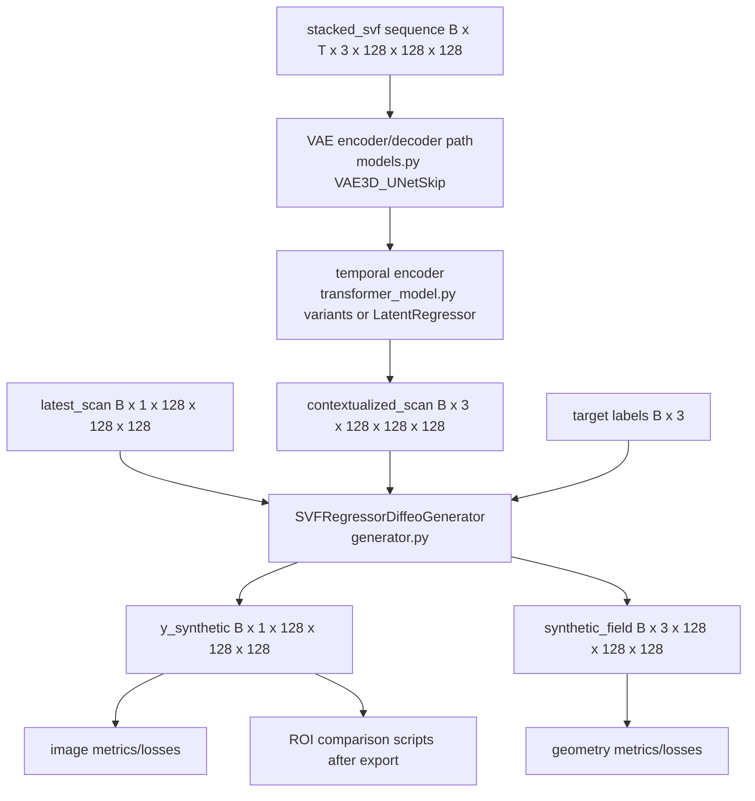
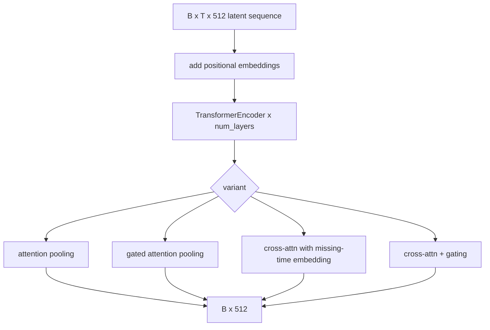
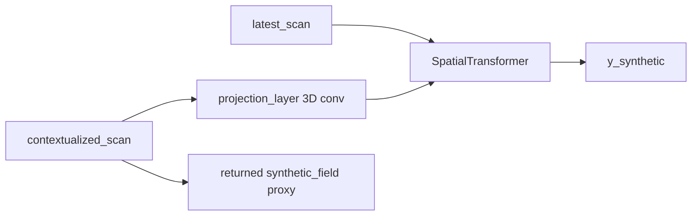

# SYNBADD: Longitudinal 3D T1 MRI Generation on ADNI

This repository implements a longitudinal, conditional 3D MRI synthesis pipeline for ADNI, where a missing scan is generated from a subject's available temporal context.

The project has two major operational phases:

1. Train model variants and save checkpoints in `/scratch/anirudhkaushik/SYNBADD/<project_name>/`.
2. Run fold-wise subject-level inference to export synthetic images and SVFs, then run downstream comparison/analysis scripts for Dice, volume, and quality metrics.

---

## 1) What This Repo Does

### Problem
Given a subject with longitudinal scans (e.g., `sc -> m06 -> m12 ...`), predict a missing target timepoint (commonly `m18`) using prior/future context and learned deformation dynamics.

### Core idea
- Represent temporal change using SVFs (stationary velocity fields).
- Encode historical SVF context with a VAE/latent path and temporal model.
- Generate:
  - synthetic target scan
  - synthetic deformation/SVF field
- Evaluate image realism, geometric consistency, anatomical overlap, and volumetric plausibility.

### Main paths in your environment
- Code: `/root/anirudhkaushik/SYNBADD`
- Models/checkpoints: `/scratch/anirudhkaushik/SYNBADD`
- Generated test artifacts per fold/run: `/scratch/anirudhkaushik/SYNBADD_Qualitative_<fold>/<run_name>/`

---

## 2) High-Level Pipeline (HLD)

### HLD components

| Layer | Responsibility | Main files |
|---|---|---|
| Data Layer | Build fold-split temporal datasets and SVF tensors | `datasets.py`, `scripts/*.py` |
| Model Layer | Generator, temporal encoders, VAE, discriminator | `generator.py`, `transformer_model.py`, `models.py`, `discriminator.py`, `ViVit/*` |
| Optimization/Metric Layer | Losses, Jacobian utilities, metric calculators | `losses.py`, `utils.py` |
| Training Layer | Train checkpoints for variants and folds | `train_VAE_SYNBADD_svf.py` (+ legacy `train_*.py`) |
| Inference Layer | Export subjectwise synthetic `.nii.gz` image + field artifacts | `test_model_subjectwise.py`, `test_*.py` |
| Comparison Layer | Baseline and ablation ROI/volume/statistical analyses | `adni_baseline_comparision_analysis.py`, `adni_remind_comparison.py`, `adni_ablations_comparision_analysis.py` |
| Orchestration Layer | Reproducible fold runs and ablation wrappers | `run_*.sh`, `eval_*.sh`, `evaluate_*.sh` |

---

## 3) Detailed Architecture (LLD)

### 3.1 Main training path (`train_VAE_SYNBADD_svf.py`)

### 3.2 Subjectwise inference/export path (`test_model_subjectwise.py`)

### 3.3 Comparison path

---

## 4) Which Models Are Used in the Current/Latest Workflow

### Latest comparison targets seen in your active ablation scripts/results
- `CrossAttentionTransformer`
- `CrossAttentionGatedTransformer`
- `GatedCrossAttentionTransformer`

These are explicitly referenced in:
- `adni_ablations_comparision_analysis.py`
- `/scratch/anirudhkaushik/SYNBADD_Qualitative_1/Results/summary_metrics_fold_1.csv`

### Flagship train/infer stack
- Generator: `SVFRegressorDiffeoGenerator` (from `generator.py`)
- Spatial encoder/decoder: VAE via `get_vae_model(...)` (`utils.py` + `models.py`)
- Temporal encoder: selectable in `transformer_model.py` via `--transformer_subtype`
- Optional adversarial: `DAFTDiscriminator` (`discriminator.py`)

Note on config vs historical runs:
- Script defaults and shell-script experiments can differ.
- For example, defaults in some files may use `GatedCrossAttention`, while recorded run names/results include `CrossAttentionTransformer+DAFT_Past+Future` variants.

---

## 5) Metrics: What Is Logged and Why

## 5.1 Training-time metrics (mainly in `train_VAE_SYNBADD_svf.py` + `losses.py`)

| Metric/Loss | Definition (implementation) | Purpose |
|---|---|---|
| `ssim_loss` | `1 - SSIM(y_synthetic, target_scan)` via `ssim_only_loss` | Encourage structural image similarity |
| `lddmm_loss` | `VxmLDDMMLoss(target, generated)` (multi-scale intensity + Jacobian regularization of registration field) | Geometry-aware alignment objective |
| `smooth_loss` | Mean squared spatial gradients of `synthetic_field` (`smooth_loss_l2`) | Prevent noisy/non-smooth deformation |
| `jac_dist_loss` | `mean((jac_det - 0.9)^2)` where `jac_det = jacobian_determinant_torch(synthetic_field)` | Keep local transform volume changes near stable target |
| `neg_jacobian_loss` | `mean(relu(-jac_det))` | Penalize foldings (non-diffeomorphic regions) |
| `d_adv` (if discriminator enabled) | `mean(softplus(-D(real))) + mean(softplus(D(fake)))` | Improve realism through adversarial signal |
| `EPE_x/y/z` | Channelwise mean absolute SVF error from `channelwise_epe_loss` | Directional field accuracy (x,y,z) |
| `angular_error` | Mean voxelwise vector angle between predicted/target field | Direction agreement in flow vectors |
| `MSE` | `F.mse_loss(normalized_generated, normalized_target)` (in `compute_metrics`) | Intensity fidelity |
| `PSNR` | `skimage.metrics.peak_signal_noise_ratio` (per-sample averaged) | Signal reconstruction quality |
| `SSIM` | `skimage.metrics.structural_similarity` (per-sample averaged) | Perceptual/structural quality |
| `NRMSE` | RMSE normalized by per-image target std (custom in `compute_metrics`) | Scale-normalized reconstruction error |
| Mean/Std Jacobian | Mean/std of `jacobian_determinant_torch(synthetic_field)` | Global deformation regularity summary |

## 5.2 Testing-time metrics (`test_model_subjectwise.py`)

All major metrics above are re-computed during testing and aggregated:
- Overall average metrics
- Timepoint-wise metrics (`sc`, `m06`, `m12`, `m18`, `m24`, `m36`)
- CSV artifact in `/scratch/anirudhkaushik/SYNBADD/<project_name>/test/<run_name>_test.csv`
- W&B logs/tables

Testing additionally exports primary artifacts per subject:
- `*_synthetic.nii.gz`
- `*_synthetic_field.nii.gz`

## 5.3 Post-hoc comparison metrics (baseline/remind/ablations)

| Metric | Where | Purpose |
|---|---|---|
| ROI Dice | `adni_*comparison*.py` | Anatomical overlap quality per ROI |
| ROI Volume | `calculate_roi_volumes` in analysis scripts | Clinical/anatomical volumetric plausibility |
| Volume diff (%) | `calculate_volume_difference` | Relative bias vs target anatomy |
| SSIM/PSNR | `get_metrics` in analysis scripts | Image-level quality vs target |
| Trajectory alignment (ReMiND script) | `calculate_trajectory_alignment` | Subject-level longitudinal consistency |

### Jacobian computation details (repo implementation)
1. Integrate SVF using scaling-and-squaring (`integrate_svf`, `VecInt`).
2. Build mapping `phi(x) = flow + identity_grid`.
3. Finite differences compute partial derivatives.
4. Assemble local 3x3 Jacobian matrix and take determinant.
5. Use determinant statistics/penalties to monitor and regularize topology.

---

## 6) Known Artifact Locations and Existing Results

Observed on server:
- Fold output roots:
  - `/scratch/anirudhkaushik/SYNBADD_Qualitative_1`
  - `/scratch/anirudhkaushik/SYNBADD_Qualitative_2`
  - `/scratch/anirudhkaushik/SYNBADD_Qualitative_3`
  - `/scratch/anirudhkaushik/SYNBADD_Qualitative_4`
  - `/scratch/anirudhkaushik/SYNBADD_Qualitative_5`

Example run directories in fold 1:
- `SYNBADD_128_6_5e-05_0.0_2025-05-22_13-44-20_ADNI_all_longitudinal_CrossAttentionTransformer+DAFT_Past+Future_Fold1`
- `SYNBADD_128_6_5e-05_0.0_2025-05-23_17-20-56_ADNI_all_longitudinal_CrossAttentionGatedTransformer+DAFT_Past+Future_Fold1`
- `SYNBADD_128_6_5e-05_0.0_2025-05-24_02-23-23_ADNI_all_longitudinal_GatedCrossAttentionTransformer+DAFT_Past+Future_Fold1`

Example produced summaries:
- `/scratch/anirudhkaushik/SYNBADD_Qualitative_1/Results/summary_metrics_fold_1.csv`
- `/scratch/anirudhkaushik/SYNBADDQualitative1/Images/metrics_summary_averaged_fold_1.csv`
- `/scratch/anirudhkaushik/SYNBADDQualitative5/Images/volume_diff_summary_fold_5.csv`

Observed sample values from current artifacts:
- Fold 1 ablation summary includes PSNR around `32.33-32.45`, SSIM around `0.9843-0.9846`, and ROI Dice columns per model.
- Averaged-impute comparison example (fold 1) shows SynBADD higher SSIM/PSNR than averaged baseline (`SSIM +0.0077`, `PSNR +3.12`).
- Fold 5 volume-diff summary example shows lower SynBADD volume error than ReMiND for sampled regions.

---

## 7) End-to-End Runbook

## 7.1 Train a model variant (5-fold loop via scripts)
Use one of:
- `run_all_PF_vae.sh`
- `run_all_P_vae.sh`
- `run_avg_impute.sh`
- `run_m18_*.sh`

Main engine script: `train_VAE_SYNBADD_svf.py`

## 7.2 Export synthetic test artifacts
Use:
- `test_model_subjectwise.py`
- fold wrappers: `eval_subjectwise_fold1.sh` ... `eval_subjectwise_fold5.sh`

Outputs:
- `/scratch/anirudhkaushik/SYNBADD_Qualitative_<fold>/<run_name>/*_synthetic.nii.gz`
- `/scratch/anirudhkaushik/SYNBADD_Qualitative_<fold>/<run_name>/*_synthetic_field.nii.gz`

## 7.3 Run comparisons
- SYNBADD vs NODER: `adni_baseline_comparision_analysis.py`
- SYNBADD vs ReMiND: `adni_remind_comparison.py`
- SYNBADD ablations: `adni_ablations_comparision_analysis.py`

Common outputs:
- Dice summary CSVs
- volume summary CSVs
- PSNR/SSIM summaries
- plots in `.../Images/` or `.../Results/`
- W&B artifacts/tables

---

## 8) Repository Structure (Folders)

| Path | Purpose |
|---|---|
| `.` | Main SYNBADD project root |
| `scripts/` | Data/SVF preprocessing utilities |
| `ViVit/` | ViViT model implementation |
| `template_csvs/` | CSV templates/configuration support |
| `notebooks/` | Exploratory notebooks |
| `Final_qualitative_results/` | Stored qualitative outputs |
| `image_results/` | Figure outputs |
| `wandb/` | Local W&B run cache/artifacts |

---

## 9) Repository Structure (Files)

### 9.1 Core training/inference/evaluation

| File | Role |
|---|---|
| `train_VAE_SYNBADD_svf.py` | Main current training pipeline |
| `test_model_subjectwise.py` | Main subjectwise inference/export pipeline |
| `adni_baseline_comparision_analysis.py` | SYNBADD vs NODER comparison |
| `adni_remind_comparison.py` | SYNBADD vs ReMiND comparison |
| `adni_ablations_comparision_analysis.py` | Intra-SYNBADD ablation comparison |
| `losses.py` | Loss/metric backend |
| `datasets.py` | ADNI/SVF dataset builders |
| `generator.py` | Generator architectures |
| `transformer_model.py` | Temporal encoder variants |
| `models.py` | VAE/regressor and supporting model defs |
| `discriminator.py` | Discriminator definitions |
| `utils.py` | Shared utility, optimizer, dataloader, VAE loading |

### 9.2 Other train/test variants (legacy or specialized)

| File | Role |
|---|---|
| `train_vae.py` | VAE-focused training |
| `train_SYNBADD_SVF.py` | Earlier SYNBADD SVF training path |
| `train_resnet_SYNBADD_svf.py` | ResNet-based SVF training variant |
| `train_model.py` | Earlier generic GAN training entrypoint |
| `train_registration.py` | Registration model training |
| `evaluate_model.py` | Alternative evaluation path |
| `test_VAE_SYNBADD_svf.py` | VAE-SYNBADD test/validate routines |
| `test_VAE_SYNBADD_dice.py` | Dice-focused testing utility |
| `test_resnet_SYNBADD_svf.py` | ResNet variant testing |
| `test_SYNBADD_SVF.py` | Legacy SYNBADD testing |
| `test_avg_impute_subjectwise.py` | Averaged-imputation subjectwise inference |
| `test_and_validate.py` | Generic test/validate helper |
| `robustness_exp.py` | Robustness experiment runner |
| `main.py` | Legacy main pipeline |

### 9.3 Baseline/analysis variants

| File | Role |
|---|---|
| `adni_avg_impute_baseline.py` | Average-imputation baseline comparison |
| `adni_forward_impute_baseline.py` | Forward-imputation baseline comparison |
| `adni_baseline_comparision_analysis.py` | NODER baseline comparison |
| `adni_remind_comparison.py` | ReMiND baseline comparison |
| `temp_adni_baseline_comparison_analysis.py` | Temporary/experimental baseline analysis |

### 9.4 Data/SVF utility scripts

| File | Role |
|---|---|
| `generate_SVF.py` | SVF generation utility |
| `generate_synthetic_svfs.py` | Synthetic SVF creation utility |
| `scripts/generate_SVF.py` | Scripted SVF generation variant |
| `scripts/encode_and_save_svfs.py` | Encode and serialize SVF latent/fields |
| `scripts/compute_svf_stats.py` | SVF statistics extraction |
| `scripts/normalize_svfs.py` | SVF normalization utility |
| `scripts/dataset_preprocessing.py` | Dataset preprocessing |
| `scripts/ADNI_file_mapper.py` | ADNI file mapping |
| `scripts/resize_adni.py` | ADNI resize utility |
| `scripts/subject-level-registration-ADNI.py` | Subject-level registration preprocessing |

### 9.5 Model helper components

| File | Role |
|---|---|
| `4d_resnet.py` | 4D/ResNet architecture utilities |
| `daft_blocks.py` | DAFT building blocks |
| `DiffeomorphicRegistration.py` | Diffeomorphic registration helper module |
| `ViVit/__init__.py` | ViViT package init |
| `ViVit/module.py` | ViViT internal modules |
| `ViVit/vivit.py` | ViViT architecture definition |
| `tempdatasetfile.py` | Temporary dataset experiments |

### 9.6 Shell orchestration entrypoints

| File | Role |
|---|---|
| `run_all_PF_vae.sh`, `run_all_P_vae.sh` | Multi-run training wrappers |
| `eval_subjectwise_fold1.sh` ... `eval_subjectwise_fold5.sh` | Fold-wise subjectwise inference wrappers |
| `evaluate_all_models.sh` | Evaluate multiple trained models |
| `eval_cross_subjectwise.sh`, `eval_crossgated_subjectwise.sh`, `eval_gatedcross_subjectwise.sh` | Ablation-specific evaluation wrappers |
| `evaluate_cross_dice_scores.sh` | Cross-model dice evaluation orchestration |
| `eval_avg_impute_all.sh`, `run_avg_impute.sh`, `avg_baseline_dice_score.sh` | Average-imputation evaluation wrappers |
| `eval_robustness.sh` | Robustness evaluation wrapper |
| `run_experiments.sh`, `run_m18_experiments.sh`, `run_m18_PvPF.sh`, `run_m18_PvPF_noDisc.sh` | Experiment launch scripts |
| `run_all_PF.sh`, `run_all_P.sh`, `run_exp_PvPF_vae.sh`, `run_adni_analysis.sh` | Additional orchestration scripts |

---

## 10) Practical Notes for New Contributors (Interns / AI Agents)

1. Start with `train_VAE_SYNBADD_svf.py`, `test_model_subjectwise.py`, and the three comparison scripts.
2. Treat `/scratch` as source-of-truth for checkpoints and generated artifacts.
3. Always keep fold and run-name alignment consistent between generation and comparison scripts.
4. Validate that expected synthetic image/field files exist before running comparisons.
5. Use W&B tables + CSV artifacts together; CSVs are easier for batch post-processing.

---

## 11) Quick Navigation

- Training core: `train_VAE_SYNBADD_svf.py`
- Inference export core: `test_model_subjectwise.py`
- Metrics backend: `losses.py`
- Data contracts: `datasets.py`
- Ablation comparator: `adni_ablations_comparision_analysis.py`
- Baseline comparators: `adni_baseline_comparision_analysis.py`, `adni_remind_comparison.py`

## 12) Results Artifact Atlas (`/scratch/anirudhkaushik`)

This section maps the major result/checkpoint folders in `/scratch/anirudhkaushik`, explains what created them, and clarifies which artifacts are relevant for the current testing setup.

### 12.1 Top-level folder map

| Path | What it contains | Produced/used by | Current relevance |
|---|---|---|---|
| `/scratch/anirudhkaushik/SYNBADD` | Project-level checkpoint folders (`*.pth`) grouped by experiment family | `train_*.py` (mainly `train_VAE_SYNBADD_svf.py`) | Primary source of model weights |
| `/scratch/anirudhkaushik/SYNBADD_Qualitative_<fold>` | Generated synthetic images/fields per run; plus ablation `Results/` in some folds | `test_model_subjectwise.py`, `adni_ablations_comparision_analysis.py` | Primary source for fold-wise inference outputs |
| `/scratch/anirudhkaushik/SYNBADDQualitative<fold>` | Comparison artifacts in `Images/` (CSV + plots) | `adni_baseline_comparision_analysis.py`, `adni_remind_comparison.py`, `adni_avg_impute_baseline.py`, `adni_forward_impute_baseline.py` | Primary baseline-comparison summaries |
| `/scratch/anirudhkaushik/NODER_result_<fold>` | NODER baseline reconstructed volumes | External baseline pipeline; consumed by baseline comparison script | Used in SYNBADD vs NODER analysis |
| `/scratch/anirudhkaushik/remind_results_<fold>` | ReMiND baseline reconstructed volumes | External baseline pipeline; consumed by ReMiND comparison script | Used in SYNBADD vs ReMiND analysis |
| `/scratch/anirudhkaushik/Averaged_Impute_masks_<fold>` | Segmentation mask outputs for average-imputation baseline | `adni_avg_impute_baseline.py` | Baseline analysis support |
| `/scratch/anirudhkaushik/ADNI_Resized_Registered_Affine` | Registered ADNI image volumes | Data preprocessing stage | Required by comparison scripts |
| `/scratch/anirudhkaushik/ADNI_Resized_Registered_segs` and `/scratch/anirudhkaushik/ADNI_Resized_Registered_baseline_segs` | Segmentation masks for ROI extraction | Data preprocessing stage | Required for Dice/volume metrics |
| `/scratch/anirudhkaushik/ADNI_Resized_Registered_brain_masks` | Brain masks used for masked image-quality metrics | Data preprocessing stage | Used by baseline/remainder comparisons |
| `/scratch/anirudhkaushik/svf_metadata.csv` | SVF metadata lookup | train/test loaders | Core dependency |
| `/scratch/anirudhkaushik/vxm_checkpoints` | Registration model checkpoints | `train_registration.py` | Secondary/legacy support |

### 12.2 Checkpoint project folders under `/scratch/anirudhkaushik/SYNBADD`

Observed high-level experiment families:

- `SYNBADD_ADNI_5FoldCrossVal_NewVAEModel_ALL_NewDatasetAndSVFS_UnetAblations`
- `SYNBADD_ADNI_5FoldCrossVal_NewVAEModel_ALL_NewDatasetAndSVFS`
- `SYNBADD_ADNI_5FoldCrossVal_NewVAEModel_ALL_NewDatasetAndSVFS_TransformerAblations`
- `SYNBADD_ADNI_5FoldCrossVal_NewVAEModel_ALL_Temporal_Ablations`
- `SYNBADD_ADNI_5FoldCrossVal_NewVAEModel_ALL_PiecewiseSVF`
- `SYNBADD_ADNI_5FoldCrossVal_FinalVAEModel_ALL_Exp` and related ablation folders
- `SYNBADD_ADNI_5FoldCrossVal_BidirectionalTransformer+Disc_ALL_Exp` and `...+NoDisc...`
- `VAE_10_Aug_per_sample` (VAE pretraining path used by `--vae_model_path` defaults)
- Additional historical folders (`TimeConditionedVAE`, `vae_evaluation`, etc.)

### 12.3 Exact checkpoint naming contract for current subjectwise testing

`test_model_subjectwise.py` expects checkpoint names in this pattern (for each run):

- `<run_name>_SYNBADD_SVF.pth`
- `<run_name>_vae_SYNBADD_SVF.pth`
- `<run_name>_transformer_SYNBADD_SVF.pth` if `--use_transformer=True`
- `<run_name>_regression_SYNBADD_SVF.pth` if `--use_transformer=False`
- `<run_name>_discriminator_SYNBADD_SVF.pth` only if `--use_discriminator=True`

For the target Unet ablations below:
- `regression` checkpoints: not present
- `discriminator` checkpoints: not present

So these runs should be evaluated with:
- `--use_transformer True`
- `--use_discriminator False`

### 12.4 Pending ablations: relevant model paths (current task)

Checkpoint root:

`/scratch/anirudhkaushik/SYNBADD/SYNBADD_ADNI_5FoldCrossVal_NewVAEModel_ALL_NewDatasetAndSVFS_UnetAblations`

#### A) `OnlyUnet+NoDAFT` runs (complete checkpoint triplets exist)

| Fold | Run name (base) |
|---|---|
| 1 | `SYNBADD_128_6_5e-05_0.0_2025-05-26_16-21-58_ADNI_all_longitudinal_CrossAttentionTransformer+OnlyUnet_Past+Future_Fold1` |
| 2 | `SYNBADD_128_6_5e-05_0.0_2025-05-26_23-38-04_ADNI_all_longitudinal_CrossAttentionTransformer+OnlyUnet_Past+Future_Fold2` |
| 3 | `SYNBADD_128_6_5e-05_0.0_2025-05-27_08-29-07_ADNI_all_longitudinal_CrossAttentionTransformer+OnlyUnet_Past+Future_Fold3` |
| 4 | `SYNBADD_128_6_5e-05_0.0_2025-05-27_14-41-32_ADNI_all_longitudinal_CrossAttentionTransformer+OnlyUnet_Past+Future_Fold4` |
| 5 | `SYNBADD_128_6_5e-05_0.0_2025-05-27_21-54-06_ADNI_all_longitudinal_CrossAttentionTransformer+OnlyUnet_Past+Future_Fold5` |

Note: Fold 1 also has an older duplicate run (`2025-05-26_06-14-22`) with complete triplets.

#### B) `NoUnet+NoDAFT` runs (complete checkpoint triplets exist)

| Fold | Run name (base) |
|---|---|
| 1 | `SYNBADD_128_6_5e-05_0.0_2025-05-28_10-18-38_ADNI_all_longitudinal_CrossAttentionTransformer+NoUnet_Past+Future_Fold1` |
| 2 | `SYNBADD_128_6_5e-05_0.0_2025-05-28_15-15-06_ADNI_all_longitudinal_CrossAttentionTransformer+NoUnet_Past+Future_Fold2` |
| 3 | `SYNBADD_128_6_5e-05_0.0_2025-05-28_21-02-34_ADNI_all_longitudinal_CrossAttentionTransformer+NoUnet_Past+Future_Fold3` |
| 4 | `SYNBADD_128_6_5e-05_0.0_2025-05-29_02-52-23_ADNI_all_longitudinal_CrossAttentionTransformer+NoUnet_Past+Future_Fold4` |
| 5 | `SYNBADD_128_6_5e-05_0.0_2025-05-29_09-56-27_ADNI_all_longitudinal_CrossAttentionTransformer+NoUnet_Past+Future_Fold5` |

### 12.5 Baseline definitions used in this project

| Baseline | Definition | Why it is useful |
|---|---|---|
| Forward imputation | Use the chronologically closest previous available scan directly as proxy for missing scan | Very intuitive lower bound; no learned synthesis |
| Averaged imputation | Average all available scans except the missing one and use this average as proxy | Stronger naive baseline; captures coarse subject appearance without learned dynamics |

These are classical imputation baselines (not generative models) and are compared against SYNBADD in:
- `adni_forward_impute_baseline.py`
- `adni_avg_impute_baseline.py`

### 12.6 Common artifact outputs and where they land

| Artifact type | Path pattern |
|---|---|
| Synthetic scan output | `/scratch/anirudhkaushik/SYNBADD_Qualitative_<fold>/<run_name>/*_synthetic.nii.gz` |
| Synthetic SVF/field output | `/scratch/anirudhkaushik/SYNBADD_Qualitative_<fold>/<run_name>/*_synthetic_field.nii.gz` |
| Ablation comparison CSV/plots | `/scratch/anirudhkaushik/SYNBADD_Qualitative_<fold>/Results/*` |
| Baseline comparison CSV/plots | `/scratch/anirudhkaushik/SYNBADDQualitative<fold>/Images/*` |

## 13) Detailed Model Architecture (Implementation-Level)

This section documents the architecture as implemented in code for the current SYNBADD pipeline (`train_VAE_SYNBADD_svf.py` + `test_model_subjectwise.py`).

### 13.1 Active runtime configuration defaults (from CLI)

- Spatial resolution: `128 x 128 x 128` (`--img_height 128`)
- Input channels: `3` (`--in_channels 3`)
- Conditioning dim: `3` (`class_label + reg_label + target_timepoint`)
- Temporal sequence length: `5` (`--seq_len 5`)
- Temporal hidden width: `512`
- Temporal depth: `2 transformer layers` (`--num_layers 2`)
- Transformer heads: `8` (hard-coded in construction)
- VAE latent width: `512`
- Generator integration steps: `10` in train path (`int_steps=10`), `12` in test subjectwise script
- Generator path toggles: `--using_unet`, `--using_daft`, `--use_transformer`, `--use_discriminator`

### 13.2 End-to-end architecture graph

### 13.3 VAE block (spatial encoder/decoder)

Implemented in `models.py` as `VAE3D_UNetSkip`.

Encoder path:
- Input: `B x 3 x 128 x 128 x 128`
- `enc1`: Conv3d(3->32, k3,s1,p1) + BN + ReLU => `32 x 128^3`
- `enc2`: Conv3d(32->64, k4,s2,p1) + BN + ReLU => `64 x 64^3`
- `enc3`: Conv3d(64->128, k4,s2,p1) + BN + ReLU => `128 x 32^3`
- `enc4`: Conv3d(128->256, k4,s2,p1) + BN + ReLU => `256 x 16^3`
- `enc5`: Conv3d(256->512, k4,s2,p1) + BN + ReLU => `512 x 8^3`
- `enc6`: Conv3d(512->512, k4,s2,p1) + BN + ReLU => `512 x 4^3`
- Flatten: `512*4*4*4 = 32768`
- Latent heads: `fc_mu(32768->512)`, `fc_logvar(32768->512)`

Decoder path:
- `fc_decode(512->32768)` then reshape to `512 x 4^3`
- Up blocks (transpose conv, stride 2) with U-Net skip concatenations:
  - up1: `512 -> 512` => `8^3`
  - up2: `(512 + skip512)=1024 -> 256` => `16^3`
  - up3: `(256 + skip256)=512 -> 128` => `32^3`
  - up4: `(128 + skip128)=256 -> 64` => `64^3`
  - up5: `(64 + skip64)=128 -> 32` => `128^3`
- Final: concat with first skip (`32 + 32 = 64`) then Conv3d(64->3), `Tanh`

```mermaid
flowchart LR
    X[3x128x128x128] --> E1[enc1 3->32 s1]
    E1 --> E2[enc2 32->64 s2]
    E2 --> E3[enc3 64->128 s2]
    E3 --> E4[enc4 128->256 s2]
    E4 --> E5[enc5 256->512 s2]
    E5 --> E6[enc6 512->512 s2]
    E6 --> MU[mu 32768->512]
    E6 --> LV[logvar 32768->512]
    MU --> Z[z 512]
    LV --> Z
    Z --> D0[fc_decode 512->32768 -> 512x4x4x4]
    D0 --> U1[up1 512->512]
    U1 --> U2[concat skip5 + up2 1024->256]
    U2 --> U3[concat skip4 + up3 512->128]
    U3 --> U4[concat skip3 + up4 256->64]
    U4 --> U5[concat skip2 + up5 128->32]
    U5 --> F0[concat skip1 + final conv 64->3 + tanh]
```

### 13.4 Temporal encoder family (`transformer_model.py`)

Common properties:
- Input tensor shape: `B x seq_len x 512`
- Core encoder: `nn.TransformerEncoderLayer(d_model=512, nhead=8)` stacked `num_layers`
- Positional embeddings: learnable by default (`1 x max_seq_len x 512`) in most variants

Implemented variants used in this repo:
- `TransformerModel` (attention pooling)
- `GatedTransformerModel`
- `CrossAttentionTransformer`
- `CrossAttentionGatedTransformer`
- `GatedCrossAttentionTransformer`
- `TransformerBidirectional`

Cross-attention variants condition pooling on missing target timepoint index via `nn.Embedding(max_seq_len, 512)`.

### 13.5 Generator block (current entrypoint class)

Primary class instantiated in train/test: `SVFRegressorDiffeoGenerator` (`generator.py`).

Important implementation notes:
- Constructor defines both U-Net and non-U-Net paths.
- Current `forward()` implementation returns the projection-layer path (non-U-Net branch):
  - `pos_flow = projection_layer(contextualized_scan)`
  - `y_source = SpatialTransformer(source, pos_flow)`
  - returns `(y_source, preint_flow)` where `preint_flow = contextualized_scan`
- U-Net + flow integration branch is present in code but currently commented in this class' `forward()`.

Generator internals relevant to architecture:
- `SpatialTransformer`: differentiable warping via `grid_sample`
- `VecInt`: scaling-and-squaring integration for SVF when used
- `ResizeTransform`: resize+rescale vector fields for integration efficiency
- U-Net feature defaults (`default_unet_features`):
  - Encoder: `[16, 32, 32, 32]`
  - Decoder: `[32, 32, 32, 32, 32, 16, 16]`
- Training script passes explicit larger feature spec in many runs:
  - Encoder: `[16, 32, 32, 32, 32]`
  - Decoder: `[32, 32, 32, 32, 32, 32, 16, 16]`

### 13.6 Discriminator / regression components

- Discriminator (optional): `DAFTDiscriminator` from `discriminator.py` when `--use_discriminator=True`
- Non-transformer temporal fallback: `LatentRegressor` (`models.py`)
  - Flatten `(seq_len * 512)` -> Linear to `1024` -> ReLU -> Linear to `512`

### 13.7 Optimization side architecture dependencies

`utils.py` couples the generator objective to a pretrained VoxelMorph model:
- Loads `VxmDense` from `/scratch/anirudhkaushik/vxm_checkpoints/best_vxm_model_64.pth`
- Wraps it in `VxmLDDMMLoss`
- This contributes registration-style intensity + Jacobian regularization terms during training/testing

### 13.8 Tensor shape reference (current main path)

| Stage | Shape |
|---|---|
| `stacked_svf` batch | `B x T x 3 x 128 x 128 x 128` |
| Temporal output | `B x 512` |
| VAE decoded context (when used) | `B x 3 x 128 x 128 x 128` |
| Generator output image | `B x 1 x 128 x 128 x 128` |
| Generator field | `B x 3 x 128 x 128 x 128` |
| Jacobian determinant tensor | `B x 127 x 127 x 127` |

### 13.9 Architecture summary for interns/agents

- Spatial context learning: 3D VAE with U-Net skip decoder (`VAE3D_UNetSkip`).
- Temporal reasoning: Transformer-family latent sequence pooling to target-timepoint-conditioned representation.
- Geometric synthesis: Generator warps source scan using predicted deformation/SVF-like field.
- Regularization: Jacobian, smoothness, LDDMM/VoxelMorph-based losses enforce plausible deformations.
- Evaluation coupling: Saved synthetic scan + field feed directly into ROI Dice/volume baseline and ablation scripts.
