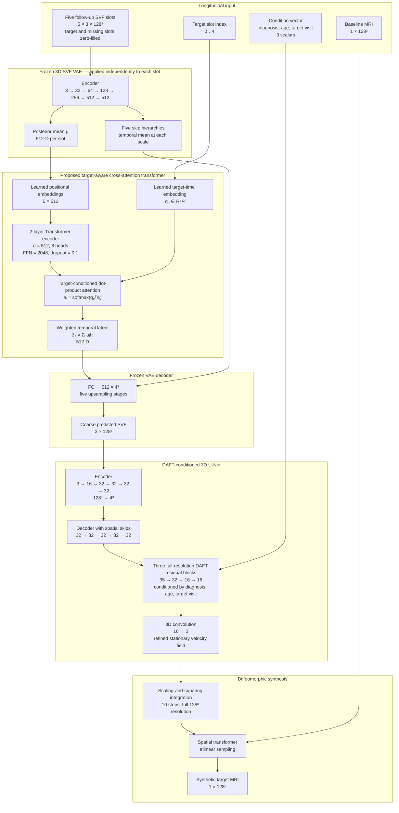

# SynBADD Main-Model Architecture

The configured main model is **CrossAttentionTransformer + 3D U-Net + DAFT**, using both past and future baseline-referenced stationary velocity fields (SVFs).

## Architecture diagram

## Configured parameters

| Component | Main setting |
|---|---|
| Input image/SVF resolution | `128 × 128 × 128` |
| Longitudinal SVF slots | 5: `m06, m12, m18, m24, m36` |
| SVF channels | 3 |
| VAE latent dimension | 512 |
| VAE encoder widths | `32, 64, 128, 256, 512, 512` |
| Temporal model | `CrossAttentionTransformer` |
| Transformer layers | 2 |
| Self-attention heads | 8 |
| Transformer FFN | 2048, inherited PyTorch default |
| Maximum sequence length | 5 |
| Positional embeddings | Learned |
| U-Net encoder | `16, 32, 32, 32, 32` |
| U-Net decoder | `32, 32, 32, 32, 32, 32, 16, 16` |
| DAFT condition dimension | 3 |
| Integration | 10 scaling-and-squaring steps |
| Integration resolution | Full resolution, `int_downsize = 1` |
| Discriminator | Disabled |
| VAE | Pretrained and frozen |

## Implementation findings

### 1. Cross-attention formulation

The longitudinal tokens first pass through an ordinary multi-head self-attention encoder. The learned target-timepoint embedding then attends to the encoded tokens using:

$$
a_i = \operatorname{softmax}_i(q_p^\top h_i),
\qquad
\hat z_p = \sum_i a_i h_i.
$$

The self-attention encoder is eight-headed, but the final target-conditioned cross-attention is a single dot-product pooling operation rather than `nn.MultiheadAttention`.

### 2. Missing slots are not attention-masked

The dataset creates a five-slot sequence and zero-fills:

- the target timepoint;
- unavailable visits;
- visits excluded by past/future ablations.

The generated `mask` is not supplied to the VAE or transformer. A zero SVF can produce a nonzero VAE latent because it passes through learned convolutions and batch-normalisation. The transformer can therefore attend to nominally missing slots.

### 3. VAE skip features are averaged without masking

At each VAE resolution, the implementation calculates a simple mean across all five temporal slots. This includes zero-filled target and missing slots after they have passed through the VAE encoder. This behaviour may contribute to the near-invariance observed in the missing-input experiments.

### 4. VAE depth and normalisation

The implementation has six encoder stages:

$$
3 \rightarrow 32 \rightarrow 64 \rightarrow 128 \rightarrow 256
\rightarrow 512 \rightarrow 512.
$$

It uses `BatchNorm3d`, not instance normalisation. The current paper description should be updated accordingly.

### 5. DAFT placement

DAFT is not applied at every U-Net layer. It is applied in three full-resolution residual blocks after the encoder–decoder path. Each block combines globally pooled image features with:

$$
[\text{diagnosis},\ \text{age},\ \text{target visit index}]
$$

and predicts channel-wise scale and shift parameters.

### 6. Condition encoding

The condition variables are passed as raw scalars:

- diagnosis: `CN = 0`, `MCI = 1`, `AD = 2`;
- subject age;
- target visit index.

They are not one-hot encoded or normalised inside the model implementation.

### 7. Baseline source image

Despite being named `latest_scan`, the source image is always loaded from the screening visit (`sc`). The final spatial transformer therefore warps the screening baseline, consistent with the baseline-referenced formulation.

### 8. Constructed but unused parameter paths

Two parameterised paths are currently constructed but unused in the main forward pass:

- `CrossAttentionTransformer.attention_fc` is instantiated but never called.
- `SVFRegressorDiffeoGenerator.project`, a roughly 6.3-million-parameter latent-to-volume projection, is instantiated but never called because the transformer output is decoded by the VAE before entering the generator.

## Implementation sources

- [`configs/experiments/cross_attn_DAFT_PF.yaml`](../configs/experiments/cross_attn_DAFT_PF.yaml)
- [`synbadd/models/temporal/cross_attention.py`](../synbadd/models/temporal/cross_attention.py)
- [`synbadd/models/vae.py`](../synbadd/models/vae.py)
- [`synbadd/models/generator.py`](../synbadd/models/generator.py)
- [`synbadd/models/daft_blocks.py`](../synbadd/models/daft_blocks.py)
- [`synbadd/models/spatial_ops.py`](../synbadd/models/spatial_ops.py)
- [`synbadd/engine/trainer.py`](../synbadd/engine/trainer.py)
- [`synbadd/data/base_dataset.py`](../synbadd/data/base_dataset.py)
